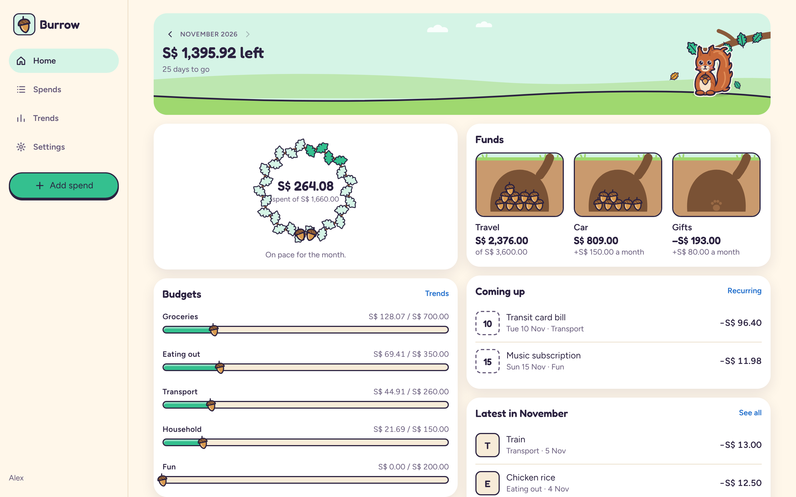
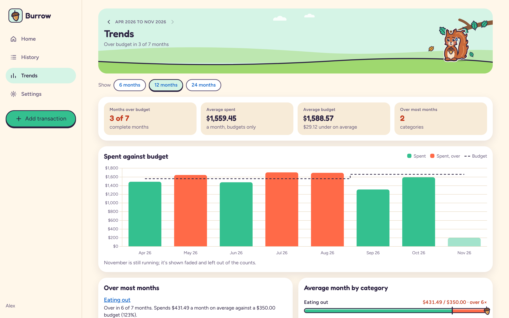
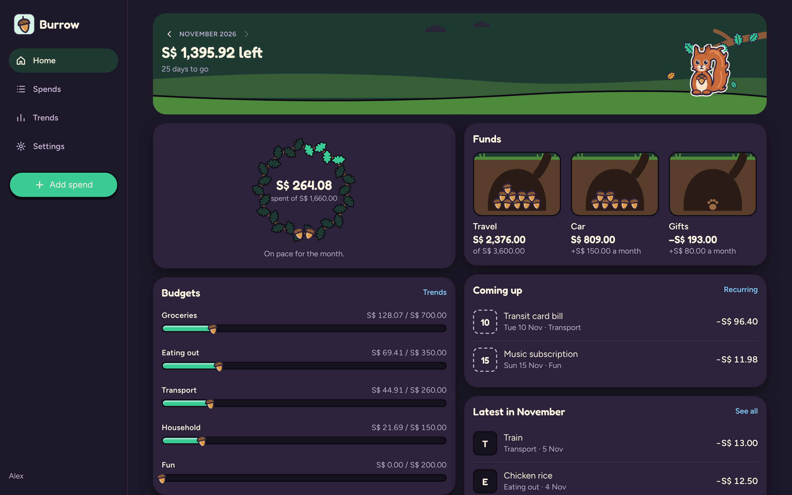
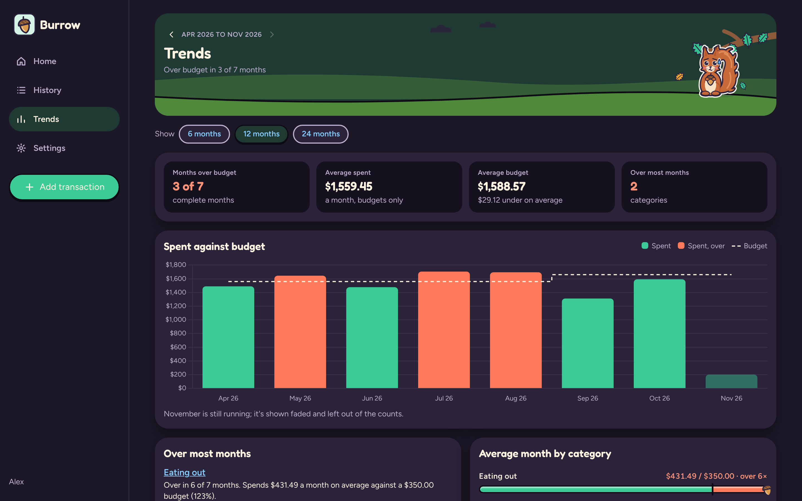
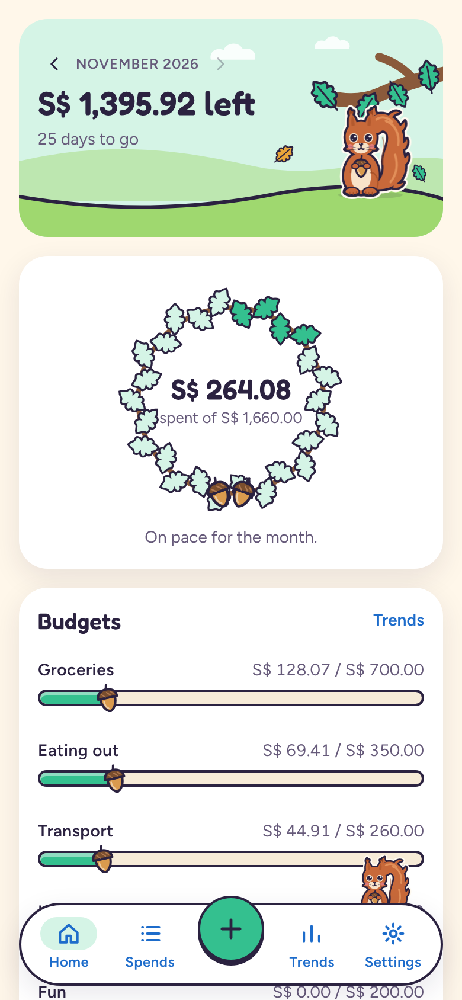
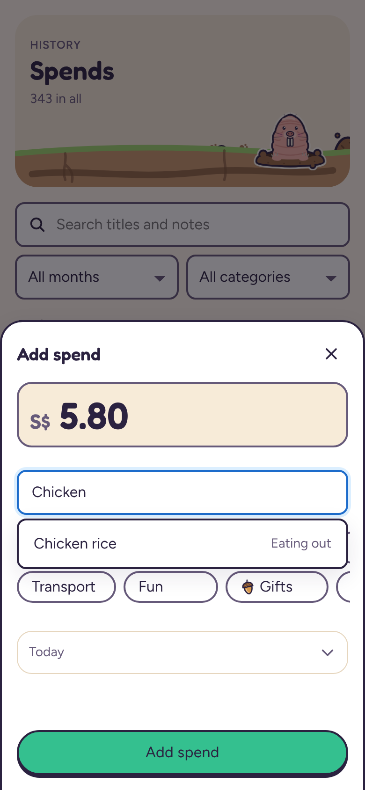
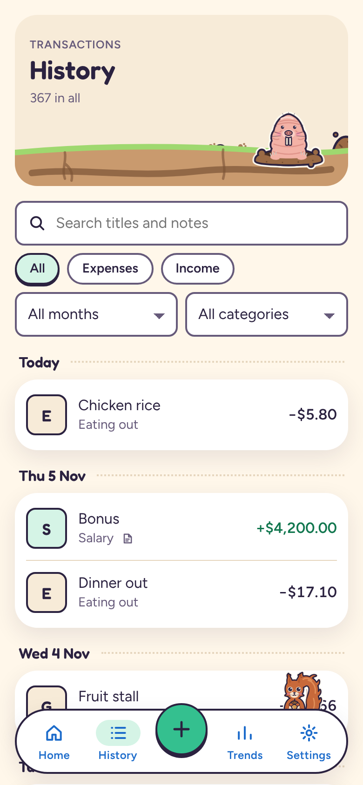
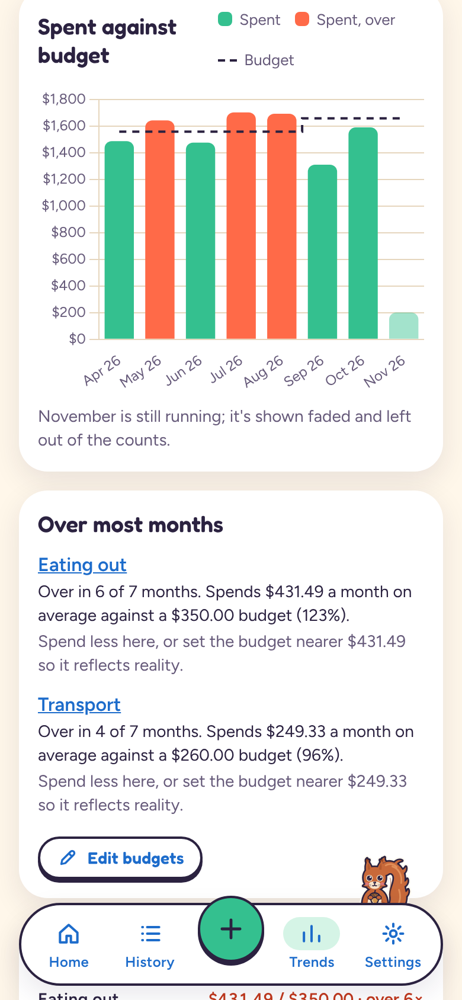

<h1 align="center">
  
  <br>
  Cache
</h1>

<h4 align="center">A self-hosted household money tracker with budgets and sinking funds.</h4>

Cache is a shared ledger for a household: everyone signs in and sees the same list of transactions, expenses and income. It started as a hard fork of [WYGIWYH](https://github.com/eitchtee/WYGIWYH) by [Herculino Trotta](https://github.com/eitchtee) and has since been rebuilt around what a household budget needs:

* **Fast entry on a phone.** One page at a time, each above the keyboard: amount on a numpad, title (a past title brings its category), category, save. Date, month, note and repeat are optional on the last page.
* **Income and expenses.** Income categories for pay and the like; money back in a budget or fund counts against what was spent. Home and Trends show what came in, what went out and what was left over.
* **Budgets.** Each category has a monthly budget. Changing it applies from a month on, so past months keep the budget they had.
* **Sinking funds.** A fund grows by a set amount on the 1st of each month and shrinks by what you spend from it. Cache tracks the balance.
* **Date and month are separate.** A bill paid on 10 June can count toward May.
* **Recurring** expenses and income are added when they fall due, so editing one changes every entry still to come.
* **Trends** show which categories go over budget month after month, and whether each fund's top-up covers what you spend from it.
* A phone-first PWA in the Burrow design system, with light and dark themes. Sign in with OIDC (for example Pocket ID).
* An MCP server at `/mcp` with OAuth, so Claude and other agents can read the ledger and log transactions. See [docs/MCP.md](docs/MCP.md).

Cache does not track upstream. The original WYGIWYH screens are still reachable under `/legacy/` while old data is imported; see [MIGRATIONS.md](MIGRATIONS.md).

<p align="center">
   
   
</p>
<p align="center">
     
</p>

# Running it

You need [Docker](https://docs.docker.com/engine/install/) with [Compose](https://docs.docker.com/compose/install/). Images are published to `ghcr.io/theepicflyer/cache` for amd64: `:X.Y.Z` and `:latest` for releases, `:nightly` for every merge to `main`.

```bash
mkdir cache && cd cache
curl -fsSLO https://raw.githubusercontent.com/theepicflyer/cache/main/docker-compose.prod.yml
mv docker-compose.prod.yml docker-compose.yml
curl -fsSL https://raw.githubusercontent.com/theepicflyer/cache/main/.env.example -o .env
$EDITOR .env    # set SECRET_KEY, SQL_PASSWORD, URL and DJANGO_ALLOWED_HOSTS

docker compose up -d

# Create the first admin account, unless ADMIN_EMAIL and ADMIN_PASSWORD are set in .env
docker compose exec -it web python manage.py createsuperuser
```

Pin a release in `docker-compose.yml` (`ghcr.io/theepicflyer/cache:1.2.0`) rather than following `:latest` if you want to choose when to upgrade. Read the release notes first: a release that needs manual steps lists them under **Deploy actions**.

## Running locally

To run Cache on your own machine, set these in `.env`:

1. Remove `URL`
2. Set `HTTPS_ENABLED` to `false`
3. Leave the default `DJANGO_ALLOWED_HOSTS` (localhost 127.0.0.1 [::1])

Then open `localhost:OUTBOUND_PORT`. If you reach it through Tailscale or another IP, add that IP to `DJANGO_ALLOWED_HOSTS` without `http://`.

For development, see [CLAUDE.md](CLAUDE.md) for the local stack, tests and release process.

## Environment Variables

| variable                      | type        | default                           | explanation                                                                                                                                                                                                                              |
|-------------------------------|-------------|-----------------------------------|------------------------------------------------------------------------------------------------------------------------------------------------------------------------------------------------------------------------------------------|
| INTERNAL_PORT                 | int         | 8000                              | The port on which the app listens on. Defaults to 8000 if not set.                                                                                                                                                                       |
| DJANGO_ALLOWED_HOSTS          | string      | localhost 127.0.0.1               | A list of space separated domains and IPs representing the host/domain names that the Cache site can serve. [Click here](https://docs.djangoproject.com/en/5.1/ref/settings/#allowed-hosts) for more details                               |
| HTTPS_ENABLED                 | true\|false | false                             | Whether to use secure cookies. If this is set to true, the cookie will be marked as “secure”, which means browsers may ensure that the cookie is only sent under an HTTPS connection                                                     |
| URL                           | string      | http://localhost http://127.0.0.1 | A list of space separated domains and IPs (with the protocol) representing the trusted origins for unsafe requests (e.g. POST). [Click here](https://docs.djangoproject.com/en/5.1/ref/settings/#csrf-trusted-origins ) for more details |
| SECRET_KEY                    | string      | ""                                | This is used to provide cryptographic signing, and should be set to a unique, unpredictable value.                                                                                                                                       |
| DEBUG                         | true\|false | false                             | Turns DEBUG mode on or off, this is useful to gather more data about possible errors you're having. Don't use in production.                                                                                                             |
| SQL_DATABASE                  | string      | None *required                    | The name of your postgres database                                                                                                                                                                                                       |
| SQL_USER                      | string      | user                              | The username used to connect to your postgres database                                                                                                                                                                                   |
| SQL_PASSWORD                  | string      | password                          | The password used to connect to your postgres database                                                                                                                                                                                   |
| SQL_HOST                      | string      | localhost                         | The address used to connect to your postgres database                                                                                                                                                                                    |
| SQL_PORT                      | string      | 5432                              | The port used to connect to your postgres database                                                                                                                                                                                       |
| SESSION_EXPIRY_TIME           | int         | 2678400 (31 days)                 | The age of session cookies, in seconds. E.g. how long you will stay logged in                                                                                                                                                            |
| ENABLE_SOFT_DELETE            | true\|false | false                             | Whether to enable transactions soft delete, if enabled, deleted transactions will remain in the database. Useful for imports and avoiding duplicate entries.                                                                             |
| KEEP_DELETED_TRANSACTIONS_FOR | int         | 365                               | Time in days to keep soft deleted transactions for. If 0, will keep all transactions indefinitely. Only works if ENABLE_SOFT_DELETE is true.                                                                                             |
| TASK_WORKERS                  | int         | 1                                 | How many workers to have for async tasks. One should be enough for most use cases                                                                                                                                                        |
| DEMO                          | true\|false | false                             | If demo mode is enabled.                                                                                                                                                                                                                 |
| ADMIN_EMAIL                   | string      | None                              | Automatically creates an admin account with this email. Must have `ADMIN_PASSWORD` also set.                                                                                                                                             |
| ADMIN_PASSWORD                | string      | None                              | Automatically creates an admin account with this password. Must have `ADMIN_EMAIL` also set.                                                                                                                                             |
| CHECK_FOR_UPDATES             | true\|false | true                              | Check and notify users about new versions. The check is done by doing a single query to Github's API every 12 hours.                                                                                                                     |
| DJANGO_VITE_DEV_MODE          | true\|false | false                             | Enables Vite dev server mode for frontend development. When true, assets are served from Vite's dev server instead of the build manifest. For development only!                                                                          |
| DJANGO_VITE_DEV_SERVER_PORT   | int         | 5173                              | The port where Vite's dev server is running. Only used when DJANGO_VITE_DEV_MODE is true. For development only!                                                                                                                          |
| DJANGO_VITE_DEV_SERVER_HOST   | string      | localhost                         | The host where Vite's dev server is running. Only used when DJANGO_VITE_DEV_MODE is true. For development only!                                                                                                                          |

## OIDC Configuration

Cache supports login via OpenID Connect (OIDC) through `django-allauth`. This allows users to authenticate using an external OIDC provider.

> [!NOTE]
> Currently only OpenID Connect is supported as a provider, open an issue if you need something else.

> [!Caution]
> Cache automatically connects OIDC accounts to existing local accounts with matching email addresses.
> This means if a user already exists with email `user@example.com` and someone logs in via OIDC with the same email, the OIDC account will be automatically linked to the existing account without requiring user confirmation.
> This is only recommended for trusted OIDC providers that verify email addresses and where you control who can create accounts.

### Configuration

To configure OIDC, you need to set the following environment variables:

| Variable             | Description                                                                                                                                                                                                                                            |
|----------------------|--------------------------------------------------------------------------------------------------------------------------------------------------------------------------------------------------------------------------------------------------------|
| `OIDC_CLIENT_NAME`   | The name of the provider. will be displayed in the login page. Defaults to `OpenID Connect`                                                                                                                                                            |
| `OIDC_CLIENT_ID`     | The Client ID provided by your OIDC provider.                                                                                                                                                                                                          |
| `OIDC_CLIENT_SECRET` | The Client Secret provided by your OIDC provider.                                                                                                                                                                                                      |
| `OIDC_SERVER_URL`    | The base URL of your OIDC provider's discovery document or authorization server (e.g., `https://your-provider.com/auth/realms/your-realm`). `django-allauth` will use this to discover the necessary endpoints (authorization, token, userinfo, etc.). |
| `OIDC_ALLOW_SIGNUP`  | Allow the automatic creation of inexistent accounts on a successfull authentication. Defaults to `true`.                                                                                                                                               |

**Callback URL (Redirect URI):**

When configuring your OIDC provider, you will need to provide a callback URL (also known as a Redirect URI). For Cache, the default callback URL is:

`https://your.cache.domain/auth/oidc/<OIDC_CLIENT_NAME>/login/callback/`

Replace `https://your.cache.domain` with the actual URL where your Cache instance is accessible. And `<OIDC_CLIENT_NAME>` with the slugfied value set in OIDC_CLIENT_NAME or the default `openid-connect` if you haven't set this variable.

# Further reading

* [docs/MCP.md](docs/MCP.md): connecting Claude or another MCP client.
* [docs/MULTI_USER.md](docs/MULTI_USER.md): setting up OIDC logins (Pocket ID) for the household. Every signed-in user shares the one ledger.
* [MIGRATIONS.md](MIGRATIONS.md): playbooks for upgrades that needed manual steps.

# Caveats

* Cache tracks spending, not wallets: there are no account balances, only fund balances.
* One currency, shown as `$`. Amounts are not converted.
* Everyone who can sign in sees and edits the whole ledger.

# Credits and license

Cache is built on [WYGIWYH](https://github.com/eitchtee/WYGIWYH), created by Herculino Trotta and its contributors. Its git history is kept in this repository up to the point Cache forked. If WYGIWYH is useful to you, consider [sponsoring its author](https://github.com/sponsors/eitchtee).

Like WYGIWYH, Cache is licensed under the [GNU Affero General Public License v3.0](LICENSE). If you run a modified version for other people over a network, you have to offer them its source.

Built with Django, Django REST framework, HTMX, _hyperscript, Procrastinate, Tailwind, DaisyUI, Vite, Chart.js and PostgreSQL.
