<h1 align="center">
  
  <br>
  Burrow
</h1>

<h4 align="center">A self-hosted finance tracker with budgets and sinking funds.</h4>

Burrow is a hard fork of [WYGIWYH](https://github.com/eitchtee/WYGIWYH) by [Herculino Trotta](https://github.com/eitchtee). It keeps everything WYGIWYH does (multi-currency accounts, transaction rules, recurring and installment transactions, a DCA tracker, import/export, an API) and adds:

* **Budgets.** A monthly budget per category, a budget tab on the monthly overview and a budget analysis page with trends.
* **Sinking funds.** Accounts marked as sinking get a monthly allocation automatically, and their balance carries over month to month.
* **Households.** A second login through OIDC that sees and edits the same shared accounts and categories.
* **An MCP server** at `/mcp` with OAuth, so Claude and other agents can read and log transactions. See [docs/MCP.md](docs/MCP.md).
* **The Burrow design system**: a new look, light and dark.

Burrow does not track upstream. Changes from WYGIWYH may be brought over by hand, but the two have diverged.

<p align="center">
  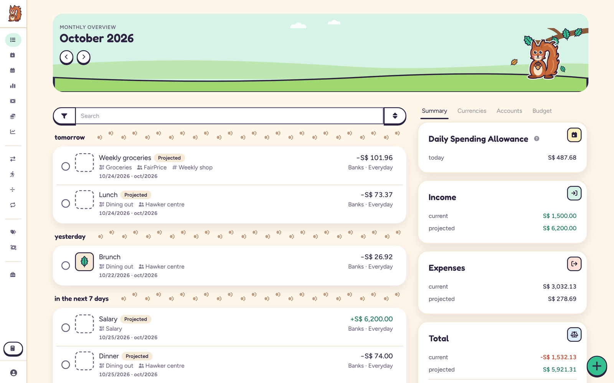 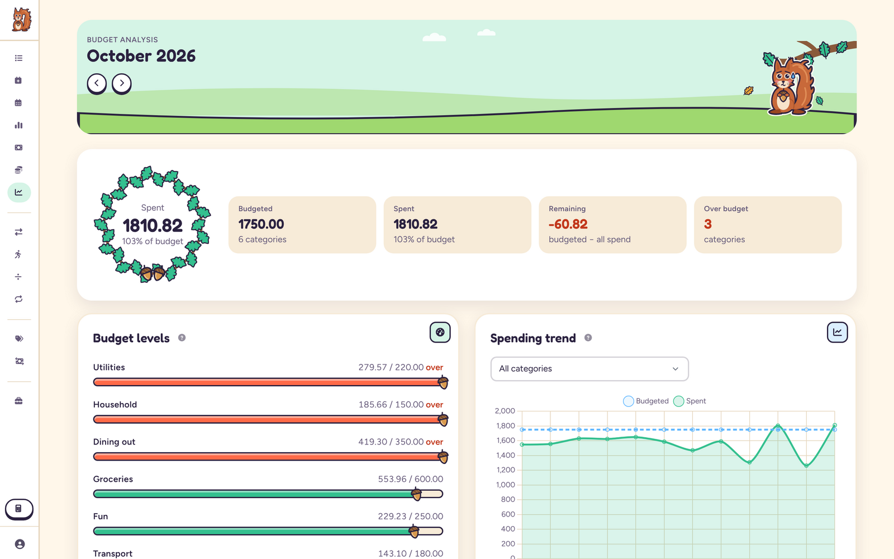
  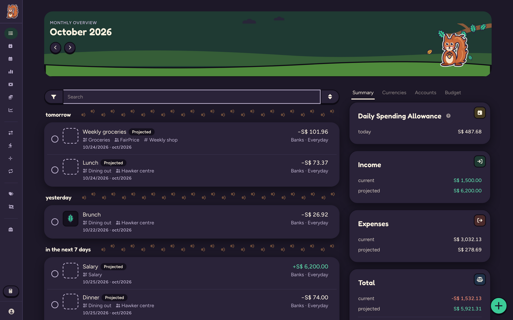 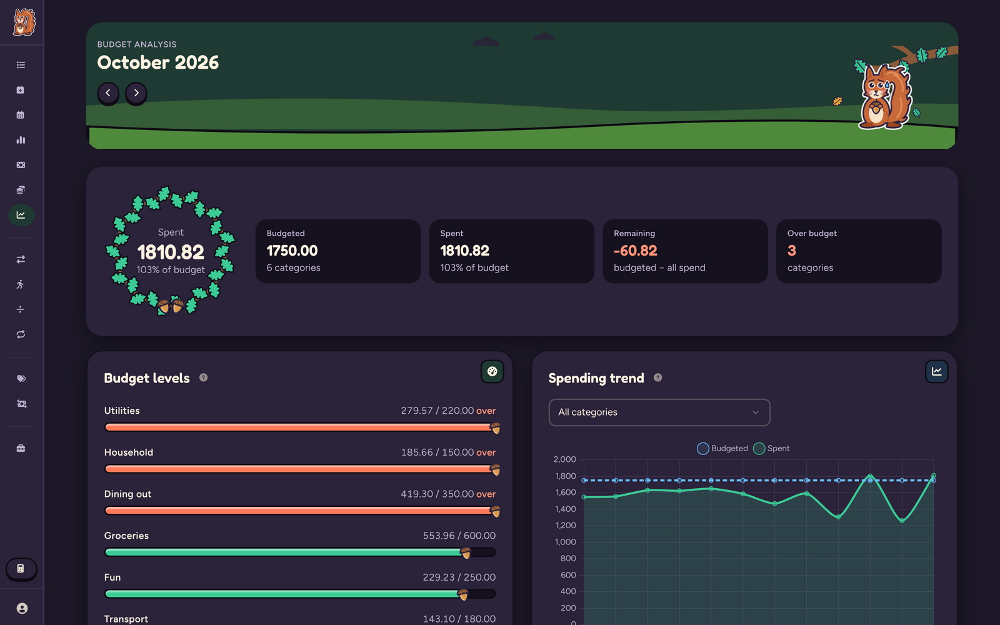
  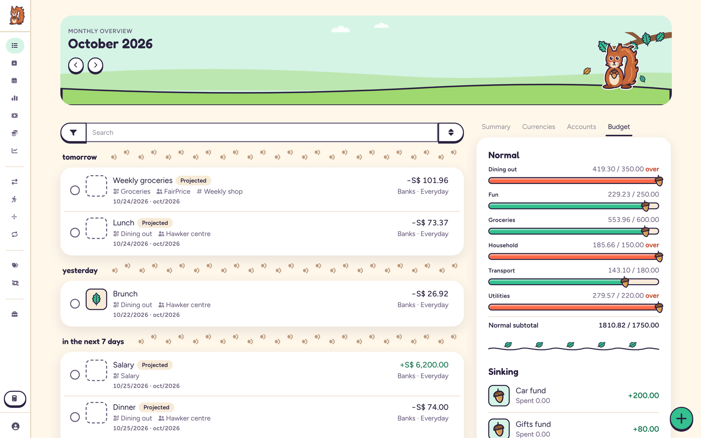 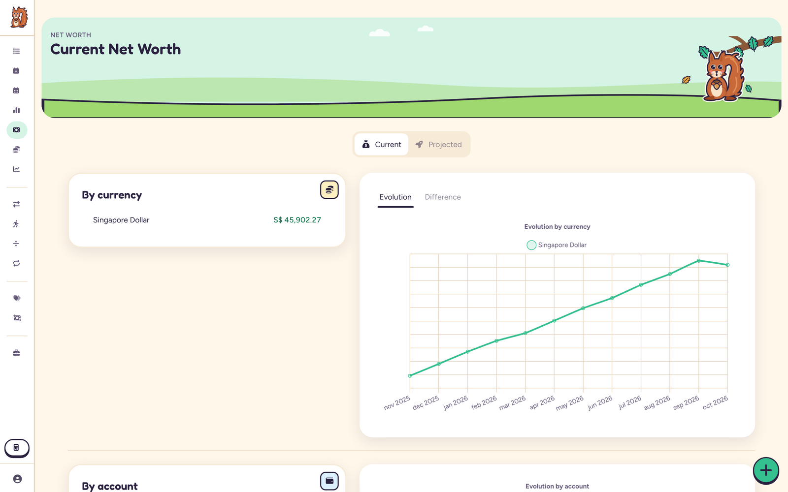 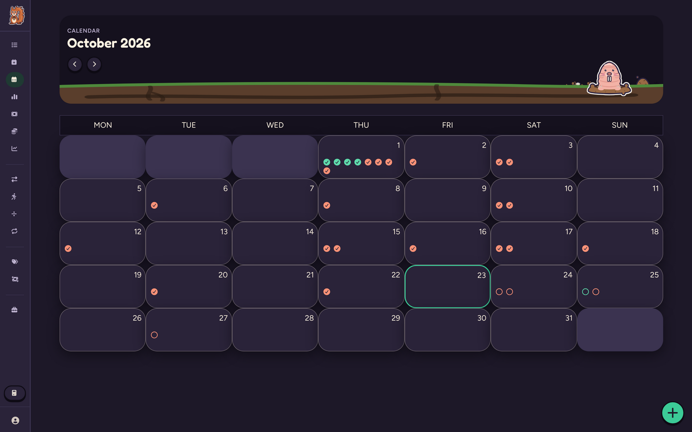
</p>
<p align="center">
  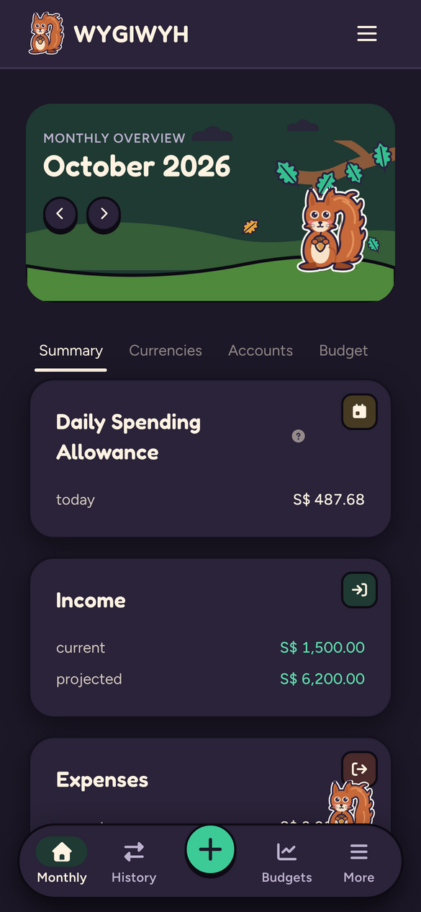 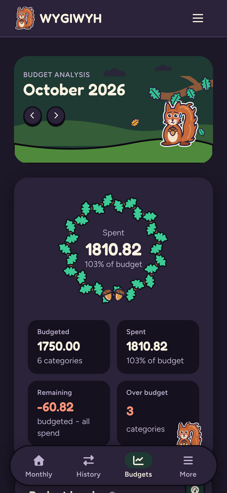 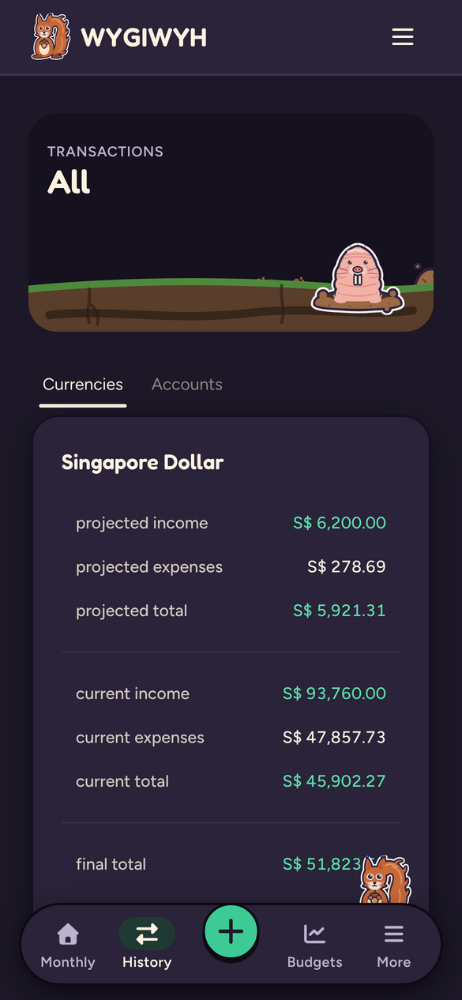 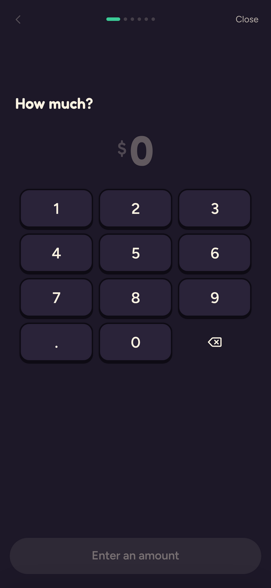
</p>

# Running it

You need [Docker](https://docs.docker.com/engine/install/) with [Compose](https://docs.docker.com/compose/install/). Images are published to `ghcr.io/theepicflyer/burrow` for amd64 and arm64: `:X.Y.Z` and `:latest` for releases, `:nightly` for every merge to `main`.

```bash
mkdir burrow && cd burrow
curl -fsSLO https://raw.githubusercontent.com/theepicflyer/burrow/main/docker-compose.prod.yml
mv docker-compose.prod.yml docker-compose.yml
curl -fsSL https://raw.githubusercontent.com/theepicflyer/burrow/main/.env.example -o .env
$EDITOR .env    # set SECRET_KEY, SQL_PASSWORD, URL and DJANGO_ALLOWED_HOSTS

docker compose up -d

# Create the first admin account, unless ADMIN_EMAIL and ADMIN_PASSWORD are set in .env
docker compose exec -it web python manage.py createsuperuser
```

Pin a release in `docker-compose.yml` (`ghcr.io/theepicflyer/burrow:1.2.0`) rather than following `:latest` if you want to choose when to upgrade. Read the release notes first: a release that needs manual steps lists them under **Deploy actions**.

## Running locally

To run Burrow on your own machine, set these in `.env`:

1. Remove `URL`
2. Set `HTTPS_ENABLED` to `false`
3. Leave the default `DJANGO_ALLOWED_HOSTS` (localhost 127.0.0.1 [::1])

Then open `localhost:OUTBOUND_PORT`. If you reach it through Tailscale or another IP, add that IP to `DJANGO_ALLOWED_HOSTS` without `http://`.

For development, see [CLAUDE.md](CLAUDE.md) for the local stack, tests and release process.

## Environment Variables

| variable                      | type        | default                           | explanation                                                                                                                                                                                                                              |
|-------------------------------|-------------|-----------------------------------|------------------------------------------------------------------------------------------------------------------------------------------------------------------------------------------------------------------------------------------|
| INTERNAL_PORT                 | int         | 8000                              | The port on which the app listens on. Defaults to 8000 if not set.                                                                                                                                                                       |
| DJANGO_ALLOWED_HOSTS          | string      | localhost 127.0.0.1               | A list of space separated domains and IPs representing the host/domain names that Burrow site can serve. [Click here](https://docs.djangoproject.com/en/5.1/ref/settings/#allowed-hosts) for more details                               |
| HTTPS_ENABLED                 | true\|false | false                             | Whether to use secure cookies. If this is set to true, the cookie will be marked as “secure”, which means browsers may ensure that the cookie is only sent under an HTTPS connection                                                     |
| URL                           | string      | http://localhost http://127.0.0.1 | A list of space separated domains and IPs (with the protocol) representing the trusted origins for unsafe requests (e.g. POST). [Click here](https://docs.djangoproject.com/en/5.1/ref/settings/#csrf-trusted-origins ) for more details |
| SECRET_KEY                    | string      | ""                                | This is used to provide cryptographic signing, and should be set to a unique, unpredictable value.                                                                                                                                       |
| DEBUG                         | true\|false | false                             | Turns DEBUG mode on or off, this is useful to gather more data about possible errors you're having. Don't use in production.                                                                                                             |
| SQL_DATABASE                  | string      | None *required                    | The name of your postgres database                                                                                                                                                                                                       |
| SQL_USER                      | string      | user                              | The username used to connect to your postgres database                                                                                                                                                                                   |
| SQL_PASSWORD                  | string      | password                          | The password used to connect to your postgres database                                                                                                                                                                                   |
| SQL_HOST                      | string      | localhost                         | The address used to connect to your postgres database                                                                                                                                                                                    |
| SQL_PORT                      | string      | 5432                              | The port used to connect to your postgres database                                                                                                                                                                                       |
| SESSION_EXPIRY_TIME           | int         | 2678400 (31 days)                 | The age of session cookies, in seconds. E.g. how long you will stay logged in                                                                                                                                                            |
| ENABLE_SOFT_DELETE            | true\|false | false                             | Whether to enable transactions soft delete, if enabled, deleted transactions will remain in the database. Useful for imports and avoiding duplicate entries.                                                                             |
| KEEP_DELETED_TRANSACTIONS_FOR | int         | 365                               | Time in days to keep soft deleted transactions for. If 0, will keep all transactions indefinitely. Only works if ENABLE_SOFT_DELETE is true.                                                                                             |
| TASK_WORKERS                  | int         | 1                                 | How many workers to have for async tasks. One should be enough for most use cases                                                                                                                                                        |
| DEMO                          | true\|false | false                             | If demo mode is enabled.                                                                                                                                                                                                                 |
| ADMIN_EMAIL                   | string      | None                              | Automatically creates an admin account with this email. Must have `ADMIN_PASSWORD` also set.                                                                                                                                             |
| ADMIN_PASSWORD                | string      | None                              | Automatically creates an admin account with this password. Must have `ADMIN_EMAIL` also set.                                                                                                                                             |
| CHECK_FOR_UPDATES             | true\|false | true                              | Check and notify users about new versions. The check is done by doing a single query to Github's API every 12 hours.                                                                                                                     |
| DJANGO_VITE_DEV_MODE          | true\|false | false                             | Enables Vite dev server mode for frontend development. When true, assets are served from Vite's dev server instead of the build manifest. For development only!                                                                          |
| DJANGO_VITE_DEV_SERVER_PORT   | int         | 5173                              | The port where Vite's dev server is running. Only used when DJANGO_VITE_DEV_MODE is true. For development only!                                                                                                                          |
| DJANGO_VITE_DEV_SERVER_HOST   | string      | localhost                         | The host where Vite's dev server is running. Only used when DJANGO_VITE_DEV_MODE is true. For development only!                                                                                                                          |

## OIDC Configuration

Burrow supports login via OpenID Connect (OIDC) through `django-allauth`. This allows users to authenticate using an external OIDC provider.

> [!NOTE]
> Currently only OpenID Connect is supported as a provider, open an issue if you need something else.

> [!Caution]
> Burrow automatically connects OIDC accounts to existing local accounts with matching email addresses.
> This means if a user already exists with email `user@example.com` and someone logs in via OIDC with the same email, the OIDC account will be automatically linked to the existing account without requiring user confirmation.
> This is only recommended for trusted OIDC providers that verify email addresses and where you control who can create accounts.

### Configuration

To configure OIDC, you need to set the following environment variables:

| Variable             | Description                                                                                                                                                                                                                                            |
|----------------------|--------------------------------------------------------------------------------------------------------------------------------------------------------------------------------------------------------------------------------------------------------|
| `OIDC_CLIENT_NAME`   | The name of the provider. will be displayed in the login page. Defaults to `OpenID Connect`                                                                                                                                                            |
| `OIDC_CLIENT_ID`     | The Client ID provided by your OIDC provider.                                                                                                                                                                                                          |
| `OIDC_CLIENT_SECRET` | The Client Secret provided by your OIDC provider.                                                                                                                                                                                                      |
| `OIDC_SERVER_URL`    | The base URL of your OIDC provider's discovery document or authorization server (e.g., `https://your-provider.com/auth/realms/your-realm`). `django-allauth` will use this to discover the necessary endpoints (authorization, token, userinfo, etc.). |
| `OIDC_ALLOW_SIGNUP`  | Allow the automatic creation of inexistent accounts on a successfull authentication. Defaults to `true`.                                                                                                                                               |

**Callback URL (Redirect URI):**

When configuring your OIDC provider, you will need to provide a callback URL (also known as a Redirect URI). For Burrow, the default callback URL is:

`https://your.burrow.domain/auth/oidc/<OIDC_CLIENT_NAME>/login/callback/`

Replace `https://your.burrow.domain` with the actual URL where your Burrow instance is accessible. And `<OIDC_CLIENT_NAME>` with the slugfied value set in OIDC_CLIENT_NAME or the default `openid-connect` if you haven't set this variable.

# Further reading

* [docs/MCP.md](docs/MCP.md): connecting Claude or another MCP client.
* [docs/MULTI_USER.md](docs/MULTI_USER.md): a second login on shared household data.
* [MIGRATIONS.md](MIGRATIONS.md): playbooks for upgrades that needed manual steps.
* The [WYGIWYH wiki](https://github.com/eitchtee/WYGIWYH/wiki) still describes how transactions, accounts, currencies, rules and DCA work. Those parts are unchanged.

# Caveats

* This is not double-entry accounting. Calculations happen at request time, which keeps the model simple but can get slow with a lot of history.
* Budget totals add amounts across currencies without converting them. The analysis page warns when more than one currency is in use.

# Credits and license

Burrow is built on [WYGIWYH](https://github.com/eitchtee/WYGIWYH), created by Herculino Trotta and its contributors. Its git history is kept in this repository up to the point Burrow forked. If WYGIWYH is useful to you, consider [sponsoring its author](https://github.com/sponsors/eitchtee).

Like WYGIWYH, Burrow is licensed under the [GNU Affero General Public License v3.0](LICENSE). If you run a modified version for other people over a network, you have to offer them its source.

Built with Django, Django REST framework, HTMX, _hyperscript, Procrastinate, Tailwind, DaisyUI, Vite, Chart.js and PostgreSQL.
